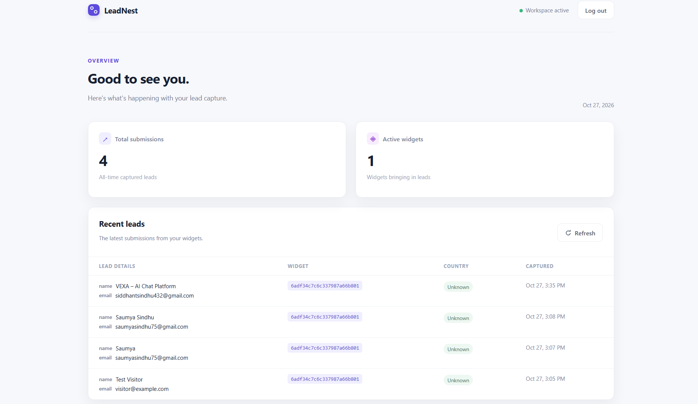
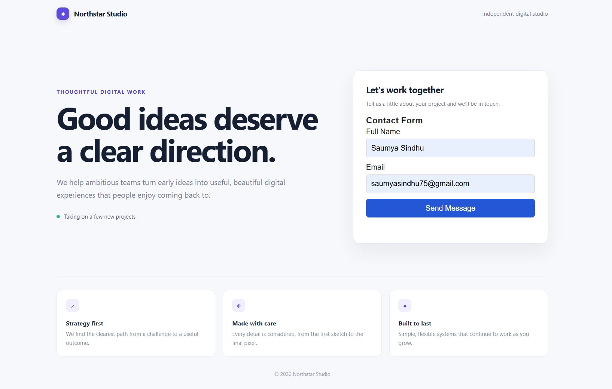
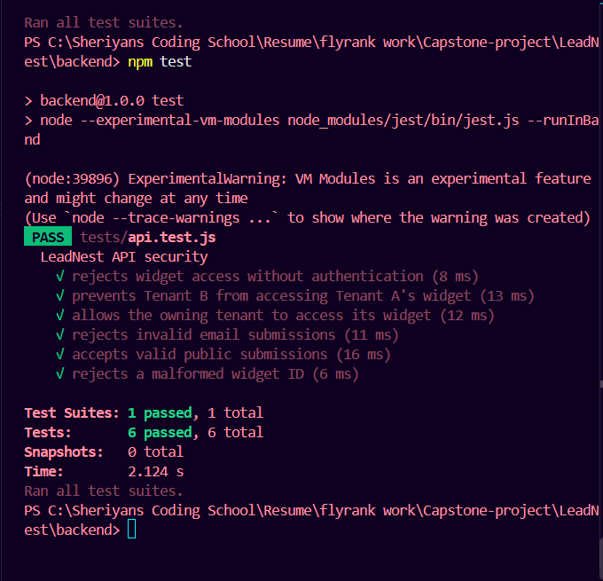

# LeadNest — Embeddable Lead Capture Platform

LeadNest is a full-stack lead capture platform that allows businesses to create customizable forms, embed them into websites using a JavaScript widget, and manage incoming leads through a dashboard.

## Features

- **Authentication:** User registration and login using JWT.
- **Multi-tenancy:** Isolated data access for different businesses.
- **Widget management:** Create, view, update, and soft-delete lead capture widgets.
- **Embeddable widget:** Add a lead capture form to a website using a script tag.
- **Submission validation:** Validate required fields, email formats, and submitted data.
- **Spam protection:** Rate limiting and a honeypot field.
- **Lead management:** View submissions and aggregated statistics through the dashboard.
- **Geolocation enrichment:** Attempt to enrich submissions with country and city information.
- **Background notifications:** Queue notification jobs with retries and simulated email processing.
- **Automated tests:** Test authentication, tenant isolation, and submission validation.

## Tech Stack

| Layer | Technologies |
|---|---|
| Frontend | React, Vite, Axios |
| Backend | Node.js, Express.js |
| Database | MongoDB, Mongoose |
| Authentication | JSON Web Tokens, bcryptjs |
| Background jobs | MongoDB-backed notification jobs |
| Testing | Jest, Supertest |
| Local database | Docker |

## Architecture

```text
Website
   |
   v
Embeddable JavaScript Widget
   |
   v
Express REST API
   |
   +---- Authentication & Tenant Isolation
   |
   +---- Widget Configuration
   |
   +---- Submission Validation & Rate Limiting
   |
   +---- Geolocation Enrichment
   |
   v
MongoDB
   |
   +---- Widgets
   +---- Users & Tenants
   +---- Submissions
   +---- Notification Jobs

React Dashboard ---> Express REST API
```

## Getting Started

### Prerequisites

- Node.js and npm
- Docker Desktop
- Git

### 1. Clone the repository

```bash
git clone <YOUR_GITHUB_REPOSITORY_URL>
cd LeadNest
```

### 2. Start MongoDB

From the backend directory:

```bash
cd backend
docker compose up -d
```

Verify the container:

```bash
docker compose ps
```

### 3. Configure environment variables

Create `backend/.env` using the example in `backend/.env.example`.

Set a strong, private `JWT_SECRET` before running the application.

### 4. Install and start the backend

From `LeadNest/backend`:

```bash
npm install
npm run dev
```

The API runs at `http://localhost:5000` by default.

Check the health endpoint:

```text
GET http://localhost:5000/api/health
```

### 5. Start the frontend

Open a second terminal:

```bash
cd frontend
npm install
npm run dev
```

Open the local URL printed by Vite, usually `http://localhost:5173`.

Register an account or log in to access the dashboard.

### 6. Run automated tests

Make sure Docker MongoDB is running, then open a terminal in `backend`:

```bash
npm test
```

**Important:** The current test suite clears the `leadnest_test` database before and after tests. Keep that database exclusively for testing; never configure it to point to production or important personal data.

## Embedding a Widget

1. Register and log in to LeadNest.
2. Create a widget through the API.
3. Copy the widget ID from the widget response.
4. Open `backend/demo/index.html`.
5. Replace `YOUR_WIDGET_ID` with the actual widget ID.
6. Open the demo page using a local HTTP server.

The embed script follows this pattern:

```html
<script
  src="http://localhost:5000/widget.js?id=YOUR_WIDGET_ID"
  defer
></script>
```

This URL is for local development. A deployed installation must use the actual public API and widget script URL.

## API Endpoints

| Method | Endpoint | Purpose |
|---|---|---|
| GET | `/api/health` | Health check |
| POST | `/api/auth/register` | Register a business account |
| POST | `/api/auth/login` | Log in |
| GET | `/api/auth/me` | Get the authenticated user |
| POST | `/api/widgets` | Create a widget |
| GET | `/api/widgets` | List the current tenant's widgets |
| GET | `/api/widgets/:id` | Get a widget |
| PATCH | `/api/widgets/:id` | Update a widget |
| DELETE | `/api/widgets/:id` | Soft-delete a widget |
| GET | `/api/public/widgets/:id/config` | Get public widget configuration |
| POST | `/api/submissions` | Submit a lead |
| GET | `/api/leads` | List leads with pagination |
| GET | `/api/leads/stats` | Retrieve lead statistics |

Protected endpoints require a bearer token:

```http
Authorization: Bearer YOUR_JWT_TOKEN
```

## Environment Variables

| Variable | Purpose |
|---|---|
| `PORT` | Backend port; defaults to `5000` |
| `MONGODB_URI` | MongoDB connection string |
| `JWT_SECRET` | Secret used to sign authentication tokens |

Never commit `.env` or expose your JWT secret.

## Current Limitations

- Email delivery is simulated; a real email provider has not yet been integrated.
- The notification worker and rate limiter are suitable for a prototype, not a horizontally scaled production deployment.
- Geolocation depends on external services and may return no location data.
- Production deployment requires HTTPS, restricted CORS, appropriate proxy settings, stronger operational monitoring, and a production-ready job queue.

## Future Improvements

- Real email delivery and configurable notification preferences
- Distributed rate limiting and a dedicated job queue
- Improved dashboard analytics and widget customization
- Production deployment with monitoring and error reporting
- Additional integration and end-to-end tests

## Author

Built as a full-stack engineering project to explore embeddable widgets, multi-tenant APIs, lead management, and background processing.


## Screenshots

### Dashboard


### Embedded Widget


### Automated Tests
